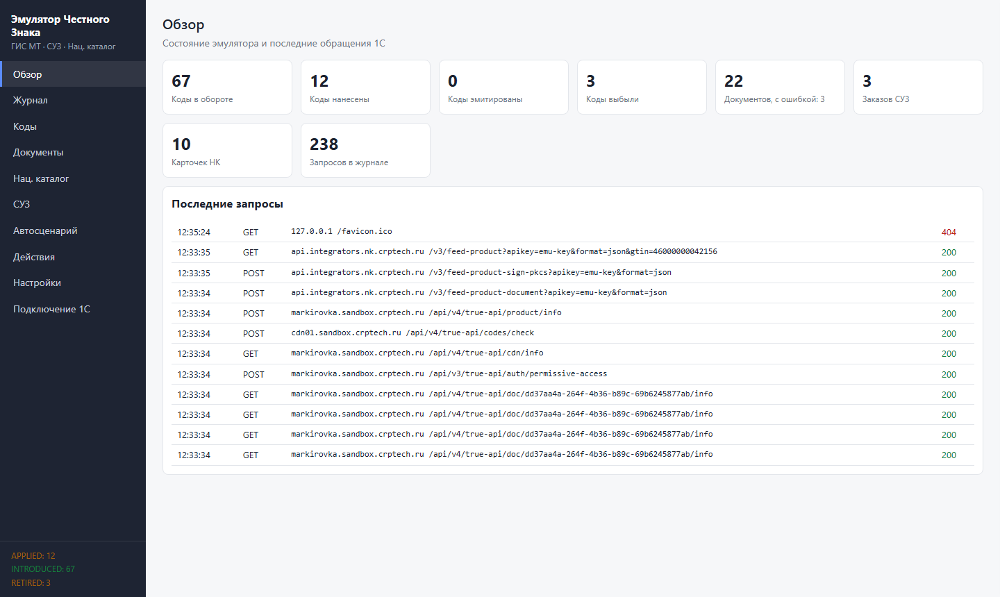
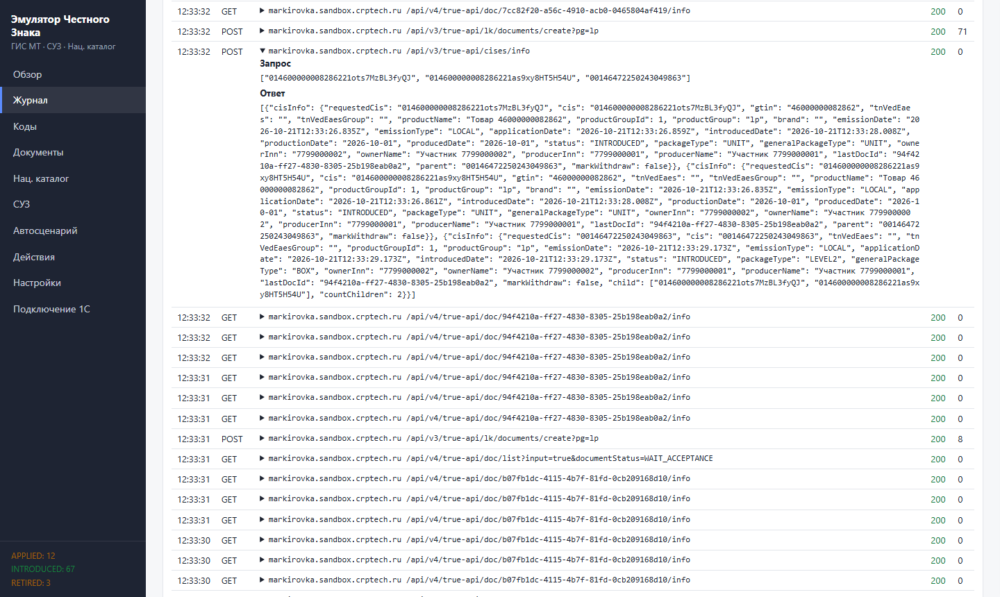
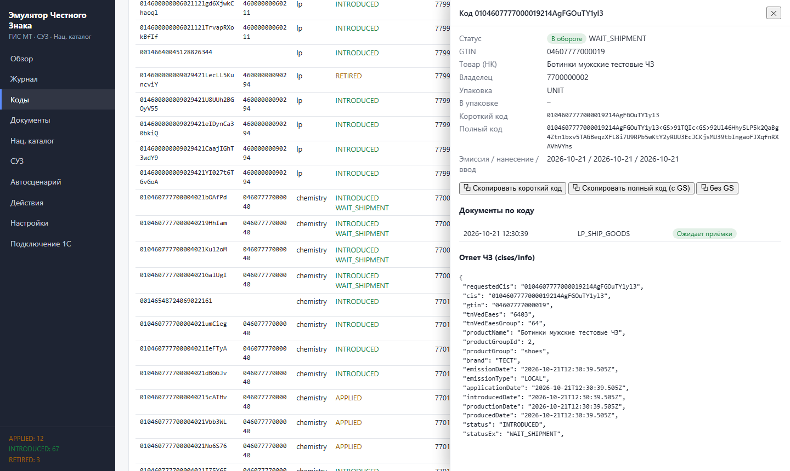
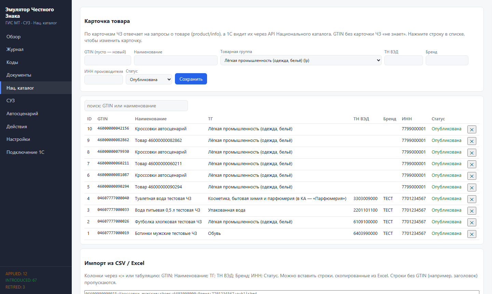
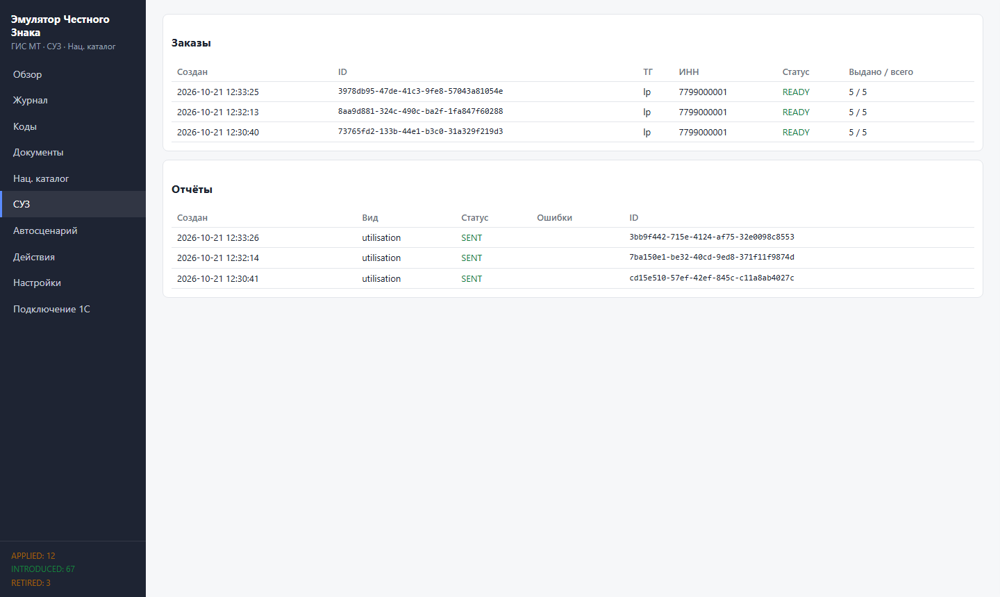
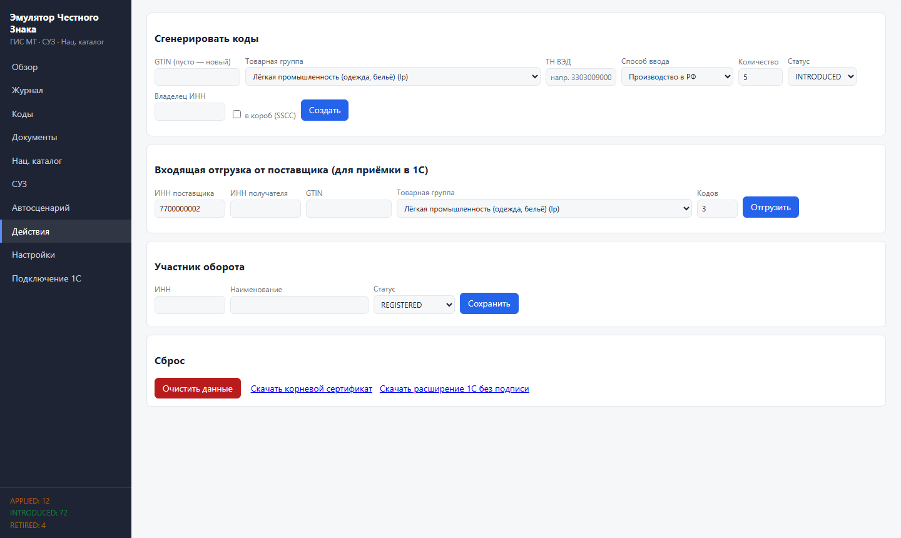
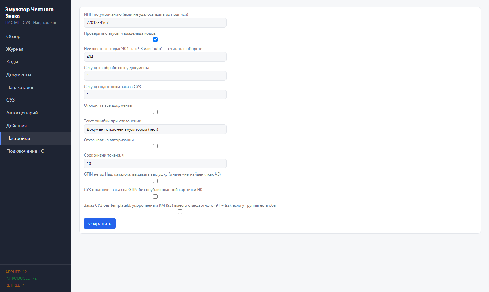
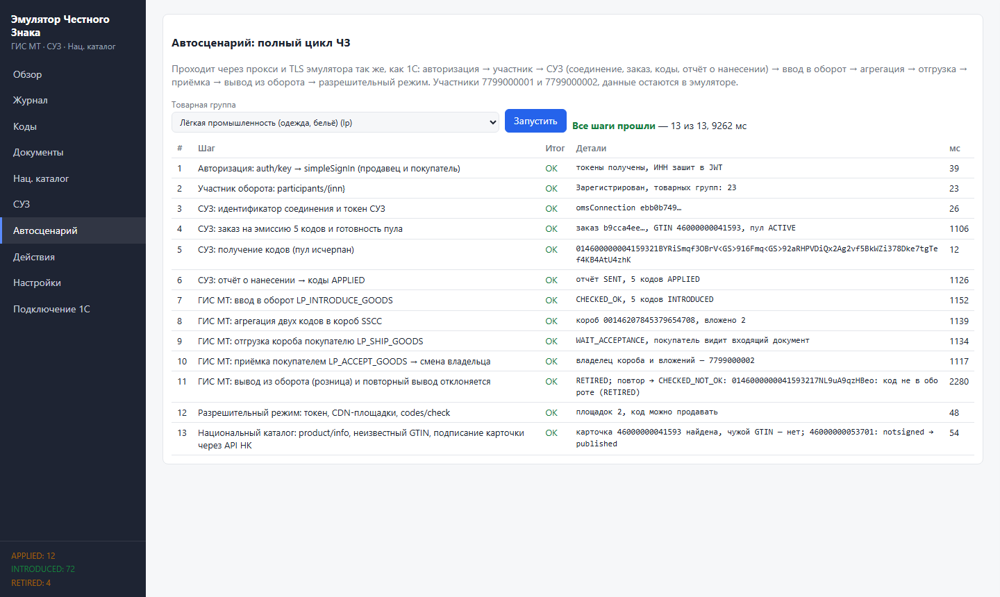
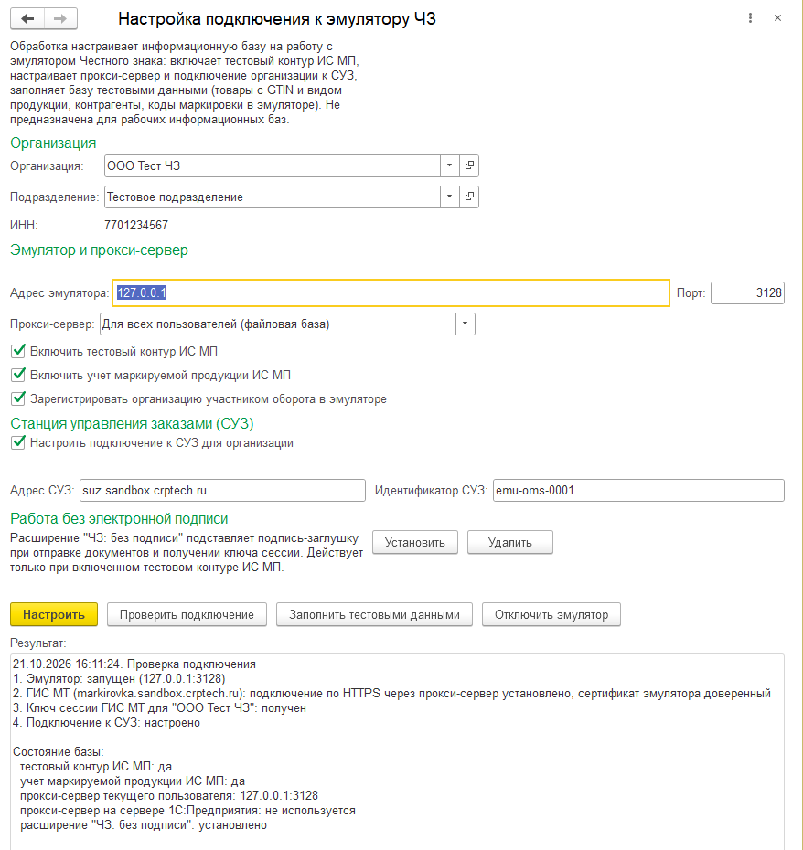
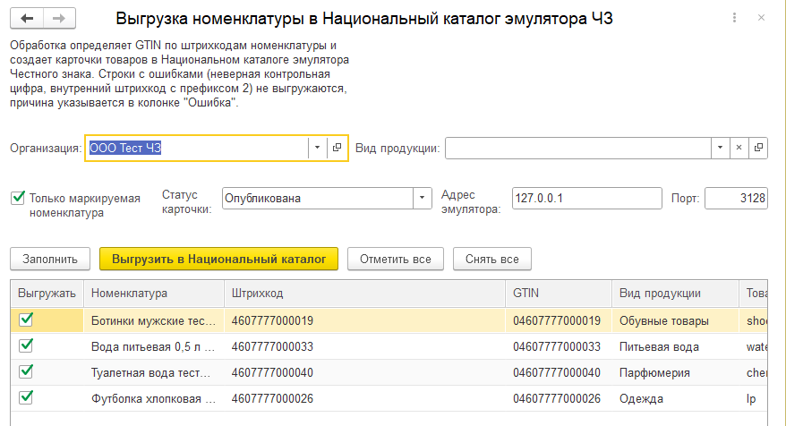

# Эмулятор Честного знака для разработки и тестирования в 1С

**Краткое описание (анонс):** Локальный эмулятор ГИС МТ (True API), СУЗ и Национального каталога. Типовая конфигурация подключается к нему без изменения кода: через тестовый контур ИС МП и прокси-сервер. Позволяет пройти полный цикл маркировки (заказ кодов, нанесение, ввод в оборот, агрегация, отгрузка, приемка, вывод из оборота) без доступа к песочнице Честного знака и без электронной подписи. В комплекте обработки настройки базы и выгрузки номенклатуры в Национальный каталог, расширение для работы без ЭП.

---

## Зачем это нужно

Доработки, связанные с маркировкой, трудно отлаживать. Песочница Честного знака требует регистрации участника, сертификата электронной подписи и КриптоПро на рабочем месте, а коды маркировки в ней приходится заказывать и вводить в оборот так же, как в рабочем контуре. Воспроизвести конкретную ситуацию (код в коробе, код другого владельца, отклоненный документ, входящая отгрузка от поставщика) получается долго, а иногда невозможно.

Эмулятор решает эту задачу локально. Он отвечает на те же запросы, что и Честный знак, хранит коды и документы в своей базе и меняет статусы кодов по правилам True API. Состояние кодов можно задать вручную: сгенерировать коды в нужном статусе, создать входящую отгрузку, включить отклонение всех документов.

## Как это устроено

Эмулятор - это одна программа (`chz-emulator.exe`, исходники на Python без сторонних пакетов), которая одновременно работает как HTTP-прокси, HTTPS-сервер Честного знака и веб-интерфейс.

1. В базе 1С включается тестовый контур ИС МП и указывается прокси-сервер `127.0.0.1:3128`.
2. Типовая конфигурация отправляет запросы на адреса Честного знака (`markirovka.sandbox.crptech.ru`, `suz.sandbox.crptech.ru` и другие) через прокси.
3. Эмулятор принимает соединения к `*.crpt.ru` и `*.crptech.ru`, устанавливает TLS своим сертификатом и отвечает как Честный знак. Соединения к остальным адресам передаются без изменений.
4. Корневой сертификат эмулятора создается при первом запуске; его нужно один раз добавить в доверенные на компьютере, где работает сервер 1С.

Конфигурация не дорабатывается: обмен идет по штатным алгоритмам библиотеки БГосИС, поэтому отлаживается именно то, что будет работать у пользователя.

Данные эмулятора (база SQLite, журнал запросов, сертификаты) хранятся в `%LOCALAPPDATA%\chz-emulator\data` и сохраняются при замене exe.

## Что эмулируется

**ГИС МТ (True API):** авторизация (`auth/key`, `auth/simpleSignIn`, токен СУЗ), участники оборота, информация о кодах (`cises/info` принимает коды в любом виде: со скобками, с разделителем GS и криптохвостом), поиск кодов, содержимое упаковок, создание документов и получение статуса, список документов, Национальный каталог (`product/info`), остатки, модули МОД, разрешительный режим (CDN, `codes/check`), выгрузки (список кодов на балансе в формате, который читает типовая), реестр согласий, локальный модуль ЧЗ.

**Документы меняют статусы кодов:**

| Документ | Что происходит с кодами |
|---|---|
| Ввод в оборот (все `LP_INTRODUCE_*`, импорт, возврат) | "В обороте", владелец - отправитель документа |
| Вывод из оборота `LK_RECEIPT`, экспорт, отмена вывода | "Выбыл" или обратно "В обороте" |
| Отгрузка, УПД, приемка, отмена отгрузки | "Ожидает приемки", у получателя входящий документ; после приемки меняется владелец |
| Агрегация, наборы, трансформация, расформирование, АТК | формируются и меняются упаковки |
| Перемаркировка `LK_REMARK` | старый код выбывает, новый вводится в оборот |
| Списание кодов | "Списан" |
| Прочие типы документов | принимаются со статусом `CHECKED_OK` |

В строгом режиме проверяются статус кода и владелец; при нарушении документ получает статус `CHECKED_NOT_OK` с текстом ошибки, как в Честном знаке.

**СУЗ (API V3 и V2):** соединение, токен, заказ кодов, статус буфера, получение кодов и повторное получение блока, закрытие заказа, отчеты о нанесении, выбытии и агрегации, квитанции. Коды генерируются по шаблонам СУЗ для товарной группы и `templateId` заказа: обувь - 13 + 91(4) + 92(88), молочная продукция - 6 + 93(4), парфюмерия и бытовая химия - 6 + 91(4) + 92(44) и так далее. Тип упаковки берется из `cisType` заказа, способ ввода в оборот - из заказа, поэтому типовая разбирает такие коды штатно.

Не эмулируется сервис 1С:Номенклатура (`api/v2/catalog/*`): он не относится к Честному знаку.

## Веб-интерфейс

Интерфейс открывается в браузере по адресу `http://127.0.0.1:3128/`.




- **Журнал** - каждый запрос 1С с телом запроса и ответа. Если метод не реализован, в журнале будет ответ 404 с адресом метода.



- **Коды, Документы, СУЗ, Нац. каталог** - текущее состояние; статус кода можно изменить вручную, полный код (с GS или без) копируется из списка.







- **Действия** - генерация кодов в нужном статусе (в том числе сразу в короб), входящая отгрузка от поставщика, регистрация участника, очистка данных.



- **Настройки** - ИНН по умолчанию, строгая проверка статусов и владельца, обработка неизвестных кодов (404 как в ЧЗ или "в обороте"), задержка обработки документов, отклонение всех документов, отказ в авторизации.



- **Автосценарий** - полный цикл через прокси и TLS без участия 1С: авторизация, участник, СУЗ (соединение, заказ, коды, отчет о нанесении), ввод в оборот, агрегация, отгрузка, приемка, вывод, разрешительный режим. Используется для проверки самого эмулятора.




## Обработки и расширение

### Настройка подключения к эмулятору ЧЗ

Внешняя обработка выполняет настройку базы, которую иначе пришлось бы делать в нескольких разделах вручную.

- **Настроить** - включает учет маркируемой продукции и тестовый контур ИС МП, записывает настройку прокси-сервера (для текущего пользователя, для всех пользователей файловой базы или на сервере 1С:Предприятия), создает станцию и подключение к СУЗ для организации, регистрирует организацию участником оборота в эмуляторе.
- **Проверить подключение** - проверяет, что эмулятор запущен, что HTTPS-запрос через прокси проходит и сертификат эмулятора доверенный, что ключ сессии ГИС МТ получен и подключение к СУЗ настроено.
- **Заполнить тестовыми данными** - создает склад, вид номенклатуры, четыре маркируемых товара (обувь, одежда, вода, парфюмерия) с видом продукции ИС, GTIN и кодом ТН ВЭД, поставщика и покупателя; в эмуляторе создает карточки Национального каталога и коды в разных статусах: в обороте, нанесенные, в коробе, во входящей отгрузке. Повторный запуск не создает дублей.
- **Отключить эмулятор** - отключает тестовый контур и прокси-сервер.

Результат каждого действия выводится в поле "Результат" вместе с текущим состоянием базы.




### Выгрузка номенклатуры в Национальный каталог эмулятора ЧЗ

Обработка отбирает штрихкоды номенклатуры, определяет по ним GTIN и создает карточки товаров в Национальном каталоге эмулятора с видом продукции, кодом ТН ВЭД и ИНН производителя. Перед выгрузкой проверяет штрихкоды: строки с неверной контрольной цифрой (с указанием правильной), с внутренним штрихкодом с префиксом 2 и без вида продукции ИС выгрузке не подлежат, причина выводится в колонке "Ошибка".




### Расширение "ЧЗ: без подписи"

Без электронной подписи типовая не получит ключ сессии и не отправит документы. Расширение подставляет подпись-заглушку при получении ключа сессии (ГИС МТ, СУЗ, розничный токен) и при отправке документов. Эмулятор подпись не проверяет.

Расширение перехватывает два метода БГосИС (`ИнтерфейсАвторизацииИСМПСлужебный.ОбновитьКлючСессииНаСервере` и `ОбменДаннымиИСМП.СообщенияКПередаче`) и действует только при включенном тестовом контуре ИС МП. При выключенном контуре поведение типовой не меняется. Расширение хранится в обработке настройки и устанавливается кнопкой "Установить"; безопасный режим для него отключается, иначе перехват не работает.

Настоящий Честный знак подпись-заглушку не примет. На рабочие базы расширение не устанавливается.

## Порядок подключения

1. Запустить `chz-emulator.exe`. Откроется окно эмулятора и веб-интерфейс.
2. Добавить корневой сертификат эмулятора в доверенные на компьютере, где работает сервер 1С (для файловой базы - на компьютере пользователя):

```
certutil -user -addstore Root "%LOCALAPPDATA%\chz-emulator\data\certs\ca.crt"
```

Для службы сервера 1С:Предприятия команда выполняется без ключа `-user` от имени администратора.

3. Открыть обработку "Настройка подключения к эмулятору ЧЗ", выбрать организацию и подразделение, нажать "Настроить".
4. При отсутствии электронной подписи установить расширение "ЧЗ: без подписи" кнопкой "Установить".
5. Перезапустить 1С. Выполнить любое действие с ИС МП и убедиться, что запросы появились на вкладке "Журнал" эмулятора.

Все шаги можно выполнить вручную, без обработки: пути меню для КА и для конфигураций на БГосИС приведены в инструкциях в комплекте.

## Совместимость

| | КА, УТ 11, ERP | Розница 3.0, УНФ и другие на БГосИС |
|---|---|---|
| Тестовый контур, прокси, регистрация в эмуляторе, проверка подключения | да | да |
| Расширение "ЧЗ: без подписи" | да | да, при режиме совместимости 8.3.27 и выше |
| Подключение к СУЗ обработкой | да | вручную (производственный объект другого типа) |
| Тестовые данные в 1С | да | вручную (нет справочников складов, партнеров, видов номенклатуры); коды и карточки в эмуляторе создаются |
| Выгрузка в Национальный каталог | да | да (без ТН ВЭД, если у номенклатуры нет реквизита) |

Обмен проверен на КА 2.5.27.93: авторизация и сохранение токена, статус участника, статусы кодов маркировки, ввод в оборот и вывод с получением статуса обработки, данные продукции по штрихкоду, поиск документов; в СУЗ - идентификатор соединения, токен, заказ, получение кодов, отчет о нанесении и его статус. Имена объектов, на которые опираются обработки и расширение, сверены с Розницей 3.0.13.363. Ответы эмулятора сверены с документацией True API версии 741.

## Ограничения

- Эмулятор предназначен только для разработки и тестирования. Прокси-сервер действует на все интернет-запросы базы: при остановленном эмуляторе база теряет доступ в интернет.
- Подпись не проверяется, ИНН участника берется из запроса или из подписываемых данных.
- Методы, которых нет в эмуляторе, возвращают 404; адрес такого метода виден в журнале.
- Прокси-сервер для веб-клиента задается в настройках браузера, поэтому настройку и проверку удобнее выполнять в тонком клиенте.

## Состав поставки

- `chz-emulator.exe` - эмулятор (Windows, установка не требуется);
- `ЭЧЗ_НастройкаПодключения.epf` - настройка базы, проверка подключения, тестовые данные, установка расширения;
- `ЭЧЗ_ВыгрузкаВНК.epf` - выгрузка номенклатуры в Национальный каталог эмулятора;
- `ЧЗ_БезПодписи.cfe` - расширение для работы без электронной подписи;
- инструкции: подключение к КА, ручная настройка для конфигураций не КА, работа с СУЗ.

Исходный код: https://github.com/Dev1100/chz-emulator
